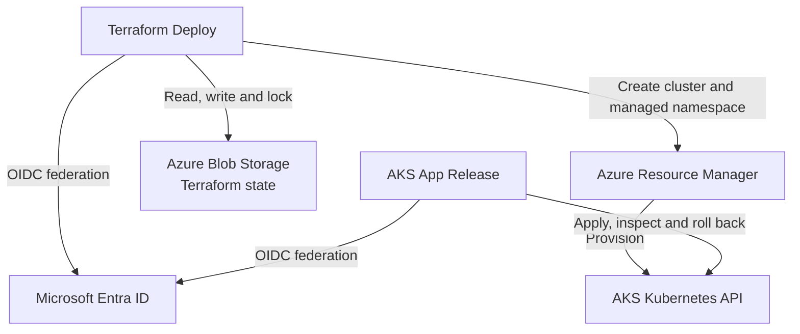
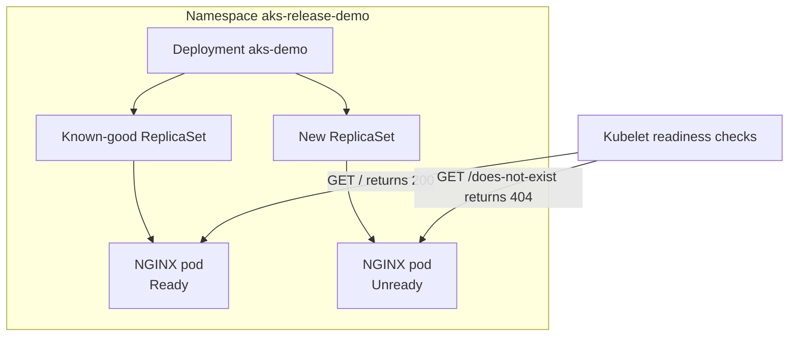
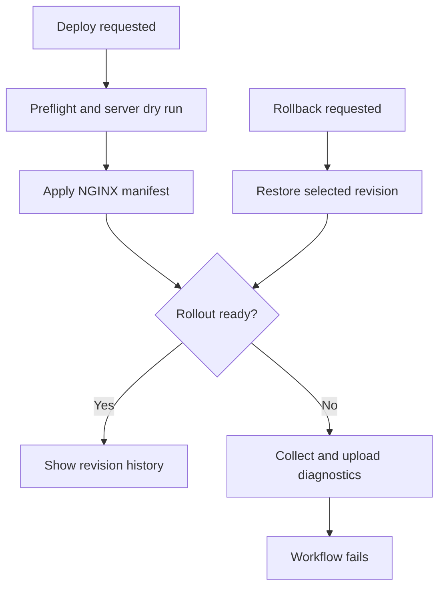
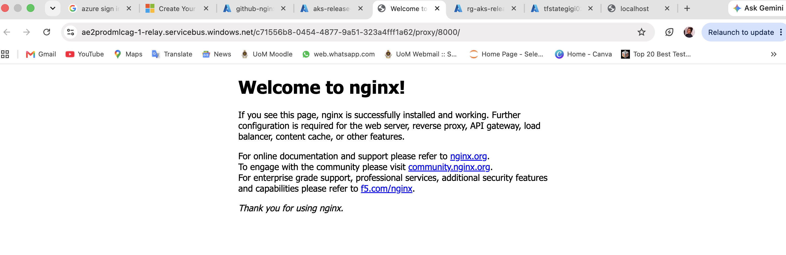
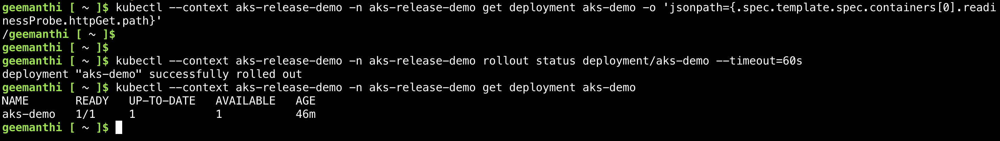

# Azure AKS Release Toolkit

Provision Azure Kubernetes Service (AKS) with Terraform, deploy NGINX through GitHub Actions, and use PowerShell to verify releases, collect failure evidence, and roll back to a known-good Kubernetes revision.

## Project objective

Demonstrate the full release lifecycle on AKS. The lab starts with a healthy NGINX deployment, introduces a deliberately incorrect readiness path, and checks that the release pipeline detects the failure and retains enough evidence to diagnose it. A manual rollback then restores the known-good pod template and runs the same readiness checks.

The demo reproduced an HTTP 404 from the new pod's readiness probe. Diagnostics showed that both containers were running and that the previous replica remained ready while the new replica stayed unready. The rollback workflow subsequently succeeded.

## Repository structure

| Path | Purpose |
| --- | --- |
| `.github/workflows/terraform-aks.yml` | **Terraform Deploy** workflow for infrastructure validation, planning, creation, and teardown |
| `.github/workflows/aks-release.yml` | **AKS App Release** workflow for manual deployment and rollback |
| `infrastructure/` | AzureRM and AzAPI configuration, variables, outputs, and the committed provider lock file |
| `k8s/deployment.yaml` | NGINX Deployment, readiness probe, replica count, and resource settings |
| `scripts/Deploy-AksRelease.ps1` | Runs the deployment sequence |
| `scripts/Test-AksPreflight.ps1` | Checks permissions and dry-runs the manifest |
| `scripts/Test-AksRelease.ps1` | Watches the rollout and collects diagnostics on failure |
| `scripts/Get-AksDiagnostics.ps1` | Captures Kubernetes resource details, events, and logs |
| `scripts/Undo-AksRelease.ps1` | Restores an explicit revision and verifies the rollout |
| `artifacts/aks-diagnostics/` | Generated diagnostics, uploaded on workflow failure and excluded from Git |

## Architecture

### Azure and GitHub Actions



Terraform manages the AKS cluster and the managed namespace through Azure Resource Manager. Azure Blob Storage holds remote state. The application workflow fetches an Entra-enabled kubeconfig into the runner and accesses the Kubernetes API using kubelogin. GitHub OIDC supplies short-lived credentials.

### Kubernetes workload



The diagram shows the deliberately failed rolling update. The Deployment selects pods with `app=aks-demo` and normally runs one replica of `nginx:stable-alpine`. The container listens on port `80` and declares a named port, `http`. The healthy readiness probe makes an HTTP request to `/` on that port. A failed readiness probe makes a pod unready while its container can continue running.

The Deployment keeps up to five old ReplicaSets for revision history and sets a 90-second progress deadline. The default rolling-update behavior allows the previous ready replica to remain while the new replica starts. The demo manifest defines a Deployment, so browser access uses a temporary port-forward.

| Resource setting | CPU | Memory |
| --- | --- | --- |
| Per-container request | `50m` | `32Mi` |
| Per-container limit | `200m` | `128Mi` |
| Example managed namespace request quota | `1000m` | `512Mi` |
| Example managed namespace limit quota | `2000m` | `1Gi` |

See the [Kubernetes Deployment documentation](https://kubernetes.io/docs/concepts/workloads/controllers/deployment/) and the [AKS managed namespace documentation](https://learn.microsoft.com/en-us/azure/aks/managed-namespaces).

## Prerequisites and RBAC

1. Create or select an Azure subscription and an existing AKS resource group, such as `rg-aks-release-demo`. Check regional quota and VM SKU availability. Register the required Azure resource providers if needed.
2. Create a separate storage account with a private blob container named `tfstate`. Enable blob versioning and ensure the runner can reach the storage endpoint. Preserve this account through cluster teardown so Terraform can read and update its state.
3. Create a Microsoft Entra app registration and service principal. Add a GitHub federated credential with issuer `https://token.actions.githubusercontent.com`, audience `api://AzureADTokenExchange`, and the exact subject emitted for your repo and deployment environment. Check the repo's OIDC subject format, including numeric IDs if GitHub uses immutable subjects.
4. In **GitHub → Settings → Environments**, configure the environment used by the workflows. The workflow examples use `dev`. Restrict deployment to the appropriate branch and match the environment name in the Entra credential.
5. Ensure the runner can reach the AKS API endpoint. For local validation or manual cluster checks, use the Terraform version pinned in the workflow, PowerShell 7.2 or later, Azure CLI, kubectl, and kubelogin as applicable.

| GitHub environment variable | Value |
| --- | --- |
| `AZURE_CLIENT_ID` | Entra application client ID |
| `AZURE_TENANT_ID` | Entra tenant ID |
| `AZURE_SUBSCRIPTION_ID` | Azure subscription ID |
| `TF_STATE_STORAGE_ACCOUNT` | Terraform state storage account name |
| `TF_STATE_CONTAINER` | `tfstate` |

| Identity | Azure role or permission | Scope |
| --- | --- | --- |
| Terraform workflow identity | Contributor | AKS demo resource group |
| Terraform workflow identity | Storage Blob Data Contributor | Terraform state container |
| Terraform workflow identity, if it manages RBAC | Permission to create and delete the relevant Azure role assignment | Managed namespace or enclosing scope |
| App release identity | Azure Kubernetes Service Cluster User Role if existing Azure permissions do not already allow kubeconfig retrieval | AKS cluster |
| App release identity | Azure Kubernetes Service RBAC Writer | Managed namespace resource ID |
| Human operator | Azure Kubernetes Service Cluster User Role for CLI credential retrieval, plus Kubernetes RBAC appropriate to the inspection or port-forward | AKS cluster or release namespace, depending on the operation |

Contributor alone cannot create Azure role assignments. If the workflow identity lacks role-assignment permissions, have an administrator grant the release identity access after the namespace exists. When Terraform derives the assignee from `data.azurerm_client_config.current.object_id`, it assigns the role to the identity running Terraform. Use an explicit app service principal object ID if the two workflows authenticate as different identities. Listing all namespaces requires cluster-scoped access.

See [AKS Entra authorization](https://learn.microsoft.com/en-us/azure/aks/entra-id-authorization), [GitHub OIDC claims](https://docs.github.com/en/actions/reference/security/oidc), and the [Terraform AzureRM backend](https://developer.hashicorp.com/terraform/language/backend/azurerm).

## How the workflows run

| Workflow operation | Execution |
| --- | --- |
| Terraform `plan` | Format check and validate, initialize the Azure backend, and preview infrastructure changes |
| Terraform `apply` | Validate, initialize, create a saved plan, and apply that plan in the same run |
| Terraform `destroy` | Validate, initialize, create a saved removal plan, and apply that plan in the same run |
| App `deploy` | Sign in with OIDC, connect to AKS, run preflight, apply the manifest, and watch rollout status |
| App `rollback` | Connect to AKS, validate the revision input, restore that revision, and watch rollout status |



The app workflow uses `aks-release-demo-ci` as the runner's kubeconfig context and `aks-release-demo` as the Kubernetes namespace. The infrastructure and application workflow examples share a concurrency group to prevent simultaneous operations against the demo cluster. Terraform `apply` and `destroy` each generate a fresh plan. A separate `plan` run previews changes.

## PowerShell scripts

| Script | Behavior |
| --- | --- |
| `Deploy-AksRelease.ps1` | Accepts a context and namespace, runs preflight, applies `k8s/deployment.yaml`, and calls release verification. |
| `Test-AksPreflight.ps1` | Uses `kubectl auth can-i` to check permissions for rollout monitoring and diagnostics. A server-side dry run checks whether the manifest can be applied without persisting changes. |
| `Test-AksRelease.ps1` | Runs `kubectl rollout status`. Supports an optional `-HealthUrl` HTTP check. On failure it attempts diagnostics collection and rethrows the release error so Actions reports a failed run. |
| `Get-AksDiagnostics.ps1` | Captures the Deployment description, ReplicaSets, pod descriptions, namespace events, and recent container logs. Individual collection failures are recorded so remaining checks can continue. |
| `Undo-AksRelease.ps1` | Calls `kubectl rollout undo --to-revision` and runs release verification. The explicit revision lets the operator select the known-good template. Supports `-WhatIf` for a local preview. |

## Create the infrastructure

1. Commit the Terraform files, workflows.
2. Run **Actions → Terraform Deploy → Run workflow**, select `main` and choose `apply` from the same branch. Confirm the workflow succeeded and the cluster appears in the Azure portal under **Kubernetes services**. Check the managed namespace and confirm the app identity has namespace access.

[Workload view in Azure Portal](docs/screenshots/azure-portal-view.png)

## Deploy and verify the baseline

1. Ensure `k8s/deployment.yaml` has `readinessProbe.httpGet.path: /`.
2. Run **Actions → AKS App Release → Run workflow → deploy** on `main`. Leave the revision field empty.
3. Expect **Deploy and verify** to succeed. Record the known-good revision from **Show deployment history**. A fresh deployment typically starts at revision `1`.

To inspect the cluster yourself, run the following after signing in to Azure and selecting the correct subscription. These commands configure the shell's kubeconfig separately from the workflow runner.

```powershell
az aks get-credentials --resource-group rg-aks-release-demo --name aks-release-demo --context aks-release-demo
kubelogin convert-kubeconfig -l azurecli

kubectl --context aks-release-demo -n aks-release-demo get deployment aks-demo
kubectl --context aks-release-demo -n aks-release-demo get pods -l app=aks-demo
kubectl --context aks-release-demo -n aks-release-demo rollout history deployment/aks-demo
```

To view NGINX from Azure Cloud Shell, run the following and leave it running. Select **Web preview → Open and browse** for port `8000`. Confirm the **Welcome to nginx!** page appears. Close the preview port and stop the command with **Ctrl+C** when done.

```powershell
kubectl --context aks-release-demo -n aks-release-demo port-forward --address 0.0.0.0 deployment/aks-demo 8000:80
```


For a terminal on your laptop, omit `--address 0.0.0.0` and open [http://localhost:8000](http://localhost:8000). See [Azure Cloud Shell Web preview](https://learn.microsoft.com/en-us/azure/cloud-shell/use-the-shell-window) and [kubectl port-forward](https://kubernetes.io/docs/reference/kubectl/generated/kubectl_port-forward/).

## Test a failed release and diagnose it

1. In the demo environment, change the readiness path from `/` to `/does-not-exist`, commit the change, and run **AKS App Release → deploy**.
2. Confirm preflight succeeds. The manifest is valid and the API server can accept it.
3. Wait for rollout verification to fail. Download **`aks-rollout-diagnostics`** from the failed run's **Summary** page. The same bundle can be generated manually from an authenticated PowerShell session in the repo root.

```powershell
./scripts/Get-AksDiagnostics.ps1 -Context aks-release-demo -Namespace aks-release-demo
```

| File or output | What to look for |
| --- | --- |
| `events.txt` | `Warning Unhealthy` and `Readiness probe failed: HTTP probe failed with statuscode: 404` |
| `pods.txt` | The old pod is `Running` and `Ready: True` with path `/`. The new pod is `Running` and `Ready: False` with path `/does-not-exist`. |
| `replicasets.txt` | Old and new ReplicaSets coexist during the stalled rolling update. |
| `deployment.txt` | Progress condition and replica counts for the stalled rollout. |
| `logs.txt` | Recent NGINX logs for the selected pods, when available. |
| Actions rollout step | `deployment "aks-demo" exceeded its progress deadline`, followed by exit code `1`. |

In the observed demo, both pods used the same NGINX image digest and had zero restarts. The new container returned HTTP 404 on the changed readiness path. The old replica remained available during the failed rollout.

## Roll back and verify recovery

1. Start a **new** **AKS App Release** run on `main`, select `rollback`, and enter the known-good **revision** recorded from the successful deployment. Use `1` only if the history identifies it as the healthy revision. A blank field fails PowerShell input validation before Kubernetes receives a rollback request.
2. Wait for **Roll back and verify** to pass.
3. Verify the live probe path, rollout, and replica counts.

```powershell
kubectl --context aks-release-demo -n aks-release-demo get deployment aks-demo -o 'jsonpath={.spec.template.spec.containers[0].readinessProbe.httpGet.path}'

kubectl --context aks-release-demo -n aks-release-demo rollout status deployment/aks-demo --timeout=60s

kubectl --context aks-release-demo -n aks-release-demo get deployment aks-demo
```



Confirm the path is `/`, the rollout succeeds, and the Deployment reports `READY 1/1`, `UP-TO-DATE 1`, and `AVAILABLE 1`. Rollout history can show a new revision number for the restored template. The NGINX welcome page is a useful HTTP smoke test, while the live probe path and rollout status verify that Kubernetes restored the intended template.

4. Restore `path: /` in Git and commit the change. Kubernetes rollback updates the live Deployment. The Git commit keeps the next deployment aligned with the recovered state.

## Destroy the infrastructure

1. Download any diagnostic artifacts you want to retain. Confirm the target subscription, backend state, and demo cluster.
2. Run **Actions → Terraform Deploy → Run workflow → destroy** on `main`. This operation applies the saved removal plan in the same run.
3. Confirm the workflow succeeds and the cluster disappears from **Azure Portal → Kubernetes services**. Terraform removes the resources tracked by its state. The managed namespace uses `deletePolicy = "Delete"`, so deletion removes its Kubernetes contents as well.
4. The pre-existing resource group, Entra application, and state storage remain when they were created outside this Terraform configuration. The AKS Free management tier still uses billable worker nodes and related Azure resources, so tear down the lab when finished.

## Common errors

| Error | Check |
| --- | --- |
| `GITHUB_TOKEN is not set, unable to resolve the latest version of kubelogin` | Pass the built-in `GITHUB_TOKEN` as a step environment variable to `azure/use-kubelogin`, or configure a specific kubelogin version. |
| `context was not found` | List contexts with `kubectl config get-contexts`. Fetch the cluster credentials in the shell where you plan to run kubectl. |
| `namespaces is forbidden` | Check the signed-in identity and role scope. Namespace Writer access covers the app namespace. Listing namespaces is a separate cluster-level operation. |
| `The managed namespace resource quota cannot be nil` | Include `body.properties.defaultResourceQuota` with `cpuRequest`, `cpuLimit`, `memoryRequest`, and `memoryLimit` in the AzAPI resource. |
| `Enter a positive deployment revision for rollback` | Start a new manual run and fill in the revision field. Re-running a job reuses the previous input. |
| Cloud Shell rejects preview port `8080` | Use `8000` for both the port-forward and the Web preview. |
